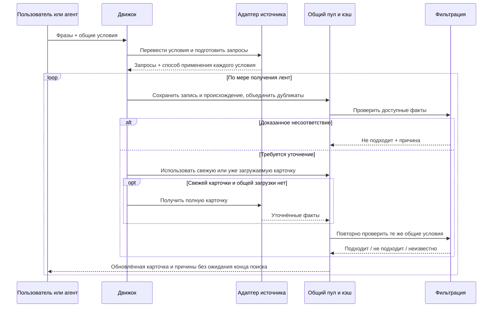

# Общий поисковый запрос: перевод, объединение и фильтрация

Статус: исходные бизнес-правила от 28.09.2026. Разделы о форматах, удалёнке, зарплате и итогах отбора заменены [спецификацией v2](product-spec-v2.md), §§3–4. Текущие поля и реализованные ограничения описаны в README. Нативные параметры и межзапусковый кэш частично реализованы; старые примеры ниже не являются текущим API-контрактом.
Область: `hh-search-prototype`, первоначально HH и Getmatch. Ниже общий план; не все способы оптимизации уже реализованы.

## 1. Один поиск — один набор условий

Пользователь или агент задаёт несколько поисковых фраз, источники и общие условия отбора. Каждая фраза расширяет общий пул. Вакансии объединяются и дедублицируются; общие условия проверяются независимо от того, какая фраза нашла вакансию.

Произвольных выражений И/ИЛИ, вложенных сценариев и `scenarios` в первой версии нет. Значения одного списка — допустимые варианты: например, офис или гибрид. Разные заполненные условия действуют одновременно. Пустое условие ничего не ограничивает. Для разных наборов условий создаются отдельные поиски; их результаты можно сравнивать в истории.

Начальный набор условий: география вакансии, место работы на удалёнке, формат работы, занятость, опыт, зарплата, дата публикации, требование помощи работодателя с переездом, исключённые компании и текст. География работодателя исключена из фильтров по решению пользователя.

Поисковые фразы сохраняются в исходном виде; пустые и повторяющиеся после удаления внешних пробелов убираются. Фразы не превращаются в обязательные слова заголовка. Поисковый синтаксис конкретного сайта не считается универсальным синтаксисом всех источников.

## 2. География

- «Где размещена вакансия»: список мест, каждое — страна и необязательный город. Страна хранится общим кодом, город — вместе со страной и подтверждённой идентичностью. Коды HH и категории Getmatch принадлежат адаптерам.
- Страна без города означает всю страну. Страна с городом означает только этот город. Россия + Москва внутри одного места не должны пропускать Казань.
- Несколько мест означают любое из них. Для запроса нескольких стран нельзя передать сайту только первую. Если сайт принимает одно место, адаптер создаёт отдельные запросы и объединяет ответы.
- «Откуда работать удалённо»: отдельное место кандидата. Оно проверяется по разрешённой географии удалённой работы. Адрес офиса, страна регистрации компании и регион публикации этого не доказывают.
- Если удалёнка не входит в выбранные форматы, поле «откуда удалённо» недопустимо. Если выбран ещё офис/гибрид, это поле проверяется только для удалённого варианта, а физические варианты — по географии вакансии. Это фиксированное правило формы, без редактора логических выражений.
- Разрешение работать из любой страны удовлетворяет ограничению «удалённо из Казахстана». Оно не доказывает, что вакансия размещена в Казахстане. Если заполнены оба условия, проверяются оба.
- Неоднозначный город требует выбора из подсказок до запуска. Несовместимая пара страна/город отклоняется. Ошибка справочника не заменяется Россией или первым найденным городом.
- При переводе страны/города сначала используется кэш соответствий, затем справочник источника. Запросы справочника расходуют тот же HTTP-бюджет источника. Ничего не выводится из VPN, IP, языка интерфейса или домена `host`.

## 3. Обязанность адаптера

Для каждого конкретного условия адаптер возвращает способ применения, реальные параметры и объяснение:

| Способ | Правило |
|---|---|
| Точно на источнике | Смысл и значения совпадают с общим условием. Передать сайту |
| Более широкая выдача | Сайт возвращает заведомое надмножество подходящих вариантов. Передать и уточнить локально |
| Только локально | Безопасного нативного ограничения нет. Получить кандидатов и проверить данные |
| Нельзя проверить | Нет безопасного перевода и доступных доказательств. Показать непроверенное условие |

Наличие одноимённого параметра недостаточно. Например, `salary` не обязательно означает «не меньше указанной суммы», а «офис или гибрид» не равно «только гибрид».

Нельзя применять приближённый параметр, который может отрезать подходящие вакансии. Если источник не умеет объединять несколько допустимых значений, нужны отдельные обращения либо более широкая выдача. Адаптер не подменяет смысл запроса молча.

Возможности объявляются по значениям и операциям: поддержка Москвы не означает поддержку любого города. Декларация описывает способность адаптера; план конкретного поиска фиксирует фактическое применение. Разрешённая нативная фильтрация не требует наличия того же поля в ответе: подтверждённое точное ограничение может служить доказательством, но его нельзя переносить на другой запрос или устаревшую карточку.

Если неподдерживаемый перевод можно заменить более широким поиском, поиск продолжается с диагностикой. Если перевод поисковой фразы вообще не получился, эта пара «фраза × источник» получает ошибку перевода; другие пары продолжают работать. Это не `0 вакансий`. Полностью неподготовленный поиск не запускается. Сбой обязательной подготовки, например разрешения страны HH, означает ошибку подготовки этого источника, а не молчаливый поиск без выбранной страны.

## 4. Конкретные переводы HH и Getmatch

Точные сведения ниже про HH проверены по публичной OpenAPI-спецификации и справочникам 28.09.2026. Сейчас прототип парсит HTML HH: параметры API нельзя автоматически объявлять проверенными параметрами HTML. Целевой вариант для расширенных фильтров HH — документированный API поиска за существующим интерфейсом парсера; его подключение и живую проверку нужно выполнить на этапе реализации. Это не требование менять интерфейсы других источников.

| Условие | HH: целевой перевод | Getmatch: перевод на подтверждённых механизмах |
|---|---|---|
| Поисковая фраза | `text`; по умолчанию поиск по всем полям, без `search_field=name` | Общая лента без `sp`; фразы не переводятся в категории. Отбор по профессии — будущая локальная фильтрация |
| Страна | Разрешить страну в `/areas` / `/areas/countries`, передать её `area` | Отдельного подтверждённого фильтра произвольной страны пока нет: проверка мест вакансии локально |
| Город | Разрешить город внутри страны; передать только его `area`, без расширяющего добавления страны | Москва → `l=moscow`, Петербург → `l=saints_p`, если требуются физические форматы. Прочие города РФ → `l=regions_ru` и проверка конкретного города, когда этот охват подходит запросу |
| Удалёнка | `work_format=REMOTE` | `l=remote`; допустимая страна удалёнки проверяется отдельно |
| Офис / гибрид | `work_format=ON_SITE` / `HYBRID` | Категории городов объединяют офис и гибрид; требуемый формат уточняется локально |
| Занятость | `employment_form` по справочнику. Точный пример: полная → `FULL`, частичная → `PART`. Остальные значения только после сопоставления смысла | Локальная проверка, пока нативное соответствие не реализовано и не проверено |
| Опыт | `experience`, если диапазон совпадает с общим условием или даёт безопасное расширение | Локально, если есть сведения; иначе неизвестно |
| Грейд | Не используется как фильтр (решение 02.10.2026) | Не применяется |
| Зарплата | В первой версии точное сравнение локально. `salary` нельзя использовать как доказанный минимум. Требование опубликованной зарплаты можно передать `label=with_salary` | Сравнение структурированной зарплаты локально; отсутствующие период/налоги не додумываются |
| Дата публикации | `date_from`, без одновременного `period`. Учесть округление HH до пяти минут: передать нижнюю безопасную границу, точную проверить локально | Локально по дате публикации |
| Помощь с релокацией | Проверка предложения помощи в полной карточке | Та же локальная проверка; `l=relocate` сам по себе не доказывает помощь |
| Исключения компаний / текста | Локально | Локально |

Для Getmatch набор `l` может выражать объединение, а не пересечение. Например, для «Москва, только удалённо» нельзя отправить `l=moscow&l=remote`: это добавит офисные вакансии и удалёнку из других мест. Отправляется `l=remote`, затем отдельно проверяется география вакансии. Если Москва указана только как место кандидата, география публикации не ограничивается.

Getmatch `l=relocate` используется для широкой категории офисной/гибридной работы вне РФ; конкретная страна и город проверяются по карточке. Этот параметр не заменяет требование помощи с переездом.

### Getmatch: общая лента вместо выбора специализации

Решение от 28.09.2026: прототип обходит `/api/offers` без `sp`. Ранее предложенный обязательный выбор специализаций отменён. Справочник специализаций и задание агенту для этого режима не нужны.

1. Один запуск обходит общую ленту один раз, независимо от количества поисковых фраз в брифе. Фразы сохраняются; capability `query=ignored`, интерфейс и журнал явно сообщают, что источник их не применяет. Бриф для такого запуска может не содержать фраз.
2. Выбранная география передаётся через повторяющиеся `l` и сохраняется при пагинации. Без выбора географии ограничение не добавляется.
3. Следующая страница: `offset = meta.offset + meta.limit`. В живом ответе первая страница содержит 12 записей при limit=10: промопубликации не должны сдвигать обычную пагинацию.
4. Обход заканчивается в конце ленты или по настроенным лимитам страниц/карточек. Во втором случае результат отмечен как ограниченный, а не полный обход.
5. Общие фильтры проверяют полученные сведения. Поисковые фразы пока не ограничивают общую ленту Getmatch, поэтому профессии могут различаться; текстовые исключения проверяются отдельно.

Приёмочные проверки: запрос без `sp` и без обращения к справочнику; отсутствие повторного обхода по нескольким фразам; пустой список фраз; сохранение географии; переходы offset=0→10→20 при дополнительных публикациях; последняя и пустая страницы; соблюдение лимитов. HH по-прежнему требует хотя бы одну фразу.

## 5. Зарплата, опыт и переезд: единый смысл

### Зарплата

Обязательны сумма, валюта и период; для налогов — до, после или «не важно». Период «за месяц» не равен «за год/час/смену».

Предлагаемый режим по умолчанию — «вилка допускает желаемую сумму». Альтернативный строгий режим — «нижняя граница не меньше желаемой». Налоговые базы и периоды должны быть сопоставимы; валюты не пересчитываются неявно. Коды валют нормализуются, например RUR → RUB; это переименование, а не конвертация. Название `salary_mode` HH обозначает период, а не выбранный нами режим сравнения вилки.

Для порога 250 тысяч в сопоставимых единицах:

| Данные вакансии | Вилка допускает | Строгая нижняя граница |
|---|---|---|
| 200–350 тысяч | Подходит по этому условию | Не подходит |
| 150–200 тысяч | Не подходит | Не подходит |
| От 300 тысяч | Подходит | Подходит |
| От 200 тысяч, верхней границы нет | Неизвестно | Не подходит |
| До 350 тысяч, нижней границы нет | Подходит по возможной сумме | Неизвестно |
| Зарплаты нет | Неизвестно | Неизвестно |
| Другая валюта, период или несопоставимая налоговая база | Неизвестно | Неизвестно |

«Подходит по возможной сумме» не означает гарантию оффера на эту сумму. Для «только вакансии с опубликованной зарплатой» отсутствие зарплаты в полностью полученной карточке — отдельное несоответствие. Пустое поле в ленте ещё не доказывает отсутствие зарплаты.

### Опыт и грейд

Грейд не используется как условие поиска или локального отбора (решение 02.10.2026). `moreThan6` не означает `lead`. Нативные диапазоны опыта можно объединять как более широкую выборку; окончательное решение опирается на сопоставимый диапазон. Если число лет означает опыт кандидата, проверяется минимальный требуемый опыт, а не обязательное попадание стажа кандидата внутрь опубликованной вилки. Неоднозначные данные остаются неизвестными.

### Помощь с релокацией

`relocation_support: true` означает, что кандидат ищет работодателя, который оплачивает
или помогает организовать переезд. `false` означает отсутствие этого требования, а не
запрет помощи. Отдельного фильтра обязательности переезда нет.

Помощь подтверждается предложением работодателя в вакансии. Зарубежный офис,
готовность кандидата переехать и категория Getmatch `relocate` не доказывают помощь.
Отсутствующие, условные или противоречивые сведения дают «неизвестно».

## 6. Дедупликация и повторное использование

1. Сначала сохраняется найденная запись и её происхождение: источник, поисковые фразы и страницы. Затем до запроса полной карточки проверяется идентичность `source + vacancy_id`; при отсутствии ID — проверенная каноническая ссылка без трекинга.
2. Одна вакансия из нескольких фраз имеет одну карточку и несколько отметок происхождения. Дубликат не расходует лимит уникальных вакансий и не создаёт ещё один запрос деталей.
3. Для одновременно выполняемых поисков один сервис разделяет уже выполняющийся запрос карточки: второй потребитель ждёт тот же результат. Отмена одного поиска не должна отменять общую загрузку, нужную другому.
4. Между поисками можно использовать успешно полученную полную карточку из БД. Предлагаемый стартовый срок свежести — 6 часов; значение настраивается глобально и для источника. Принудительное обновление игнорирует сохранённую карточку, но сохраняет объединение одновременных запросов.
5. Изменившаяся версия вакансии, значимые изменения ленты, срок свежести или версия парсера инвалидируют кэш. При отсутствии признаков изменения действует срок свежести. Это компромисс: при повторном использовании неизвестные изменения карточки могут быть замечены с задержкой до срока обновления.
6. Ошибка/капча/неполный разбор не считается успешной карточкой кэша. Повторы одной операции ограничены общей политикой ретраев, а не запускаются заново при каждом повторном нахождении. Новый поиск может повторить неудачную загрузку.
7. Ленты при новом поиске обходятся заново — иначе не увидеть новые вакансии. Одинаковые HTTP-запросы ленты можно объединить в рамках одного запуска; долгосрочный кэш лент по умолчанию выключен.
8. Кэшируются данные, а не решение «подходит». При новом брифе и новой версии правил данные оцениваются заново; прошлые запуски остаются снимками.
9. Похожие названия на HH и Getmatch не доказывают одну вакансию. До загрузки объединение между источниками допустимо только по надёжной общей идентичности. Иначе сохраняются обе записи; возможные дубли можно связать после получения данных.
10. Гарантия объединения одновременных обращений действует внутри одного сервиса. Все агенты используют его API и одну БД; отдельные экземпляры сервиса не координируются скрытой глобальной блокировкой.

## 7. Порядок фильтрации и результаты

Общий пул обрабатывается потоком, без ожидания окончания всех источников:

Для не исключённых вакансий полная карточка загружается при наличии соответствующего компонента источника либо берётся из свежего кэша: пользователю нужен полный текст, даже если часть условий уже проверена по ленте. Если источник отдаёт полный текст сразу, дополнительный запрос не нужен.

Предварительное исключение допустимо только по достаточным данным, которые уточнение не должно менять. Отсутствующий текст или поле ленты — не достаточное основание. Эвристическая догадка не выдаётся за доказанный факт; противоречивые сведения требуют уточнения.

Финальный результат по условию: подходит / не подходит / неизвестно. По вакансии: любое доказанное несоответствие → не подходит; иначе наличие неизвестного → требует проверки; иначе подходит. Неизвестное не вызывает бесконечное обогащение и не удерживает запуск в работе.

При отключённой постфильтрации состояние — «не проверено», а не «подходит». Нативные условия поисковых обращений продолжают действовать; интерфейс показывает, какие условия остались непроверенными. Переключатель должен называться «Постфильтрация», чтобы не обещать отключение нативного поиска.

Запросы одного источника обслуживаются по очереди с чередованием: первая страница каждой подготовленной фразы получает возможность выполниться до второй страницы первой фразы. Общий бюджет всё равно имеет приоритет; не начатые из-за лимита пары отмечаются явно, а не выдаются за пустую выдачу.

Достижение лимита уникальных кандидатов или страниц завершает сбор нормально, но явно ограничивает полноту. Лимит кандидатов не равен обещанию получить столько же подходящих вакансий. Ошибки запросов и парсинга делают результат частичным; просто отсутствие фактов для некоторого фильтра не является ошибкой HTTP или зависанием.

## 8. Что должно быть видно в журнале

- Исходные фразы и общий набор условий; версия правил и парсера.
- Для каждого условия: точный/расширенный/локальный/непроверяемый перевод, причина и фактические параметры обращения.
- Все фразы происхождения вакансии; объединение запросов, повторных находок и использование кэша с возрастом данных.
- Предварительное и финальное решения по каждому условию, использованные поля, их источник и причина неизвестности.
- Число сырых находок, уникальных кандидатов, повторов, загрузок и попаданий в кэш, подходящих/отклонённых/непроверенных; ошибки и достигнутые ограничения.

## 9. Приёмочные примеры для последующей реализации

| Вход / ситуация | Ожидаемое поведение |
|---|---|
| HH, страна Казахстан | В обращении `area` Казахстана из справочника; нигде нет подстановки России |
| HH, Казахстан + Алматы | Только ID Алматы; страна не расширяет поиск на весь Казахстан |
| HH, удалёнка из Казахстана, география вакансии не задана | Формат remote; Казахстан не становится ограничением региона публикации |
| Две страны на источнике с одним регионом на запрос | Два обращения, один пул; ни одна страна не потеряна |
| Россия + Москва как одно место; вакансия Казань | Не подходит по географии |
| Getmatch, Москва + только удалённо | Не использовать объединение `l=moscow&l=remote` как пересечение |
| Python только в описании, вакансия Backend Engineer | Нет автоматического отказа по заголовку |
| Getmatch: произвольные фразы или отсутствие фраз | Один обход общей ленты; режим явно показан, выбора специализаций нет |
| Порог 250 тыс., вилка 200–350 тыс. | В обычном режиме проходит; в строгом не проходит |
| Запрошено net, известен только gross | Неизвестно, без автоматического отказа или налогового пересчёта |
| Нужна помощь с релокацией, указан только зарубежный офис | Помощь не подтверждена: неизвестно |
| Стаж более шести лет | Не присваивать автоматически lead |
| Одна карточка найдена тремя фразами одновременно | Одна загрузка, одна запись в пуле, три происхождения |
| Два запуска ждут одну карточку; один отменён | Второй получает результат, общей загрузке не мешает отмена первого |
| Повторный поиск со свежей карточкой | Лента запрашивается, детали переиспользуются, новые условия проверяются заново |
| После полной карточки зарплата неизвестна | Поиск заканчивается; вакансия остаётся в непроверенной группе |
| Нативный фильтр дал точное соответствие, поле не возвращено | Можно использовать подтверждённое применение фильтра как доказательство с происхождением |
| Условия источника и факты карточки противоречат друг другу | Зафиксировать конфликт; не выдавать безусловное соответствие |

## Основания и границы проверки

- [Официальная OpenAPI HH](https://api.hh.ru/openapi/redoc#tag/Poisk-vakansij/operation/get-vacancies) и [спецификация](https://api.hh.ru/openapi/specification/public): параметры поиска, семантика зарплаты, даты и `host`.
- [Текущие справочники HH](https://api.hh.ru/dictionaries): форматы, занятость, опыт, области поиска и `with_salary`.
- Getmatch: параметры `sp` и повторяющиеся `l` подтверждены браузерными запросами и живыми проверками прототипа 28.09.2026. Остальные нативные фильтры пока не объявлены реализованными.
- Основные исходные ошибки воспроизведены при анализе v2: фиксированная Россия, объединение страны и города как альтернатив, фильтр только заголовка, сравнение зарплаты по нижней границе и смешение опыта с грейдом.

Предлагаемые решения для согласования: обычный зарплатный режим «вилка допускает сумму»; срок свежести деталей 6 часов; использование официального API HH для расширенных нативных фильтров. Реализация начинается отдельным шагом после обсуждения этих правил.
