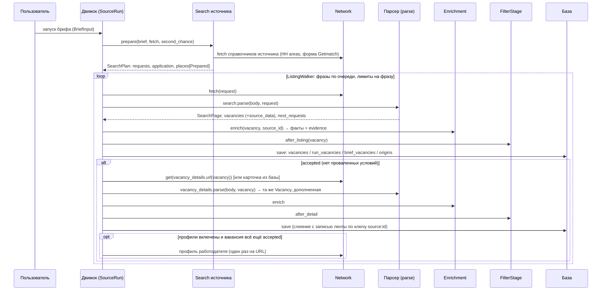

# Поток данных источника: слои, контракты и параметры брифа

Дата: 04.11.2026. Статус: черновик для ревью.
Описывает код рабочей копии на 04.11.2026 (этапы 1–4 [плана фактов](vacancy-facts-plan.md) выполнены).
Связанные документы: [спецификация v2](product-spec-v2.md), [план фактов](vacancy-facts-plan.md),
[требования к географии источника](source-geography-implementation-requirements.md).

Назначение: одна схема, по которой (1) добавляется новый источник, (2) настраиваются верификаторы,
(3) параллельные работы по разным источникам не пересекаются. Раздел 1 — как устроено сейчас,
разделы 2–6 — целевой контракт, раздел 7 — чек-лист добавления источника и проверки верификаторов,
раздел 8 — расхождения кода с контрактом.

---

## 0. Главная идея в одном абзаце

Бриф записан в **общем словаре** (ISO-страны, `geoname_id` городов, четыре формата работы, ISO-валюта…).
Каждый источник умеет **переводить в обе стороны**: вперёд — условие брифа в параметры своего запроса
(с честной пометкой «точно / шире / не умею»), назад — сырые данные своей вакансии в **факты того же словаря**
(с пометкой происхождения). Парсер ничего не толкует, он только извлекает. Фильтр ничего не разбирает,
он только сравнивает поле брифа с полем факта. Выдача источника по запросу — не доказательство:
всё, что источник «отфильтровал», проверяется заново по фактам.

```text
         словарь брифа                                 словарь брифа
  Бриф ──► перевод вперёд ──► запросы ──► сырые данные ──► перевод назад ──► факты ──► сравнение ──► решение
  (L1)        (L2, источник)     (L3, движок)   (L4, парсер)     (L5, обогатитель)   (L6, база)   (L7, фильтр)
                     ▲                                               ▲
                     └──────────── справочники (L0): CLDR, GeoNames, справочники источника ──┘
```

---

## 1. Как работает сейчас (ответы на вопросы)

### 1.1 Путь одной вакансии



### 1.2 Ответы по пунктам

| Вопрос | Как сейчас |
|---|---|
| Что такое бриф | `BriefInput`: имя, текст, до 10 фраз `queries`, условия `filters: SearchFilters`, опции поиска (источники, лимиты, профили, второй шанс). Места — `filters.locations[]` (`SearchPlace`), у каждого места свой минимум формата и требование релокации. |
| «Движок отправляет бриф в парсер» | Почти: движок вызывает `adapter.search.prepare(brief, fetch, second_chance)`. Компонент `Search` источника **чистый**: он не ходит в сеть сам, а получает от движка `fetch` для справочников (подсказки городов HH, форма зон Getmatch). Результат — `SearchPlan`: список запросов, режим применения каждого условия (`native / local / none / ignored`) и по каждому месту — перевод каждого условия (`Prepared`: параметры, статус `exact / broader / unsupported / ambiguous / not_found / error`, причина, источник значения). |
| Кто выполняет план | Движок: `ListingWalker` обходит фразы по кругу (первые страницы всех фраз раньше вторых), лимиты — новые уникальные вакансии и страницы на фразу. Пагинацию задаёт парсер: `SearchPage.next_requests`. Сеть — `Network` (интервалы, повторы, предохранитель, распознавание капчи/VPN/блокировки через `classify`). |
| Как разбирается лента | `search.parse(body, request)` → `SearchPage(vacancies, total, next_requests)`. Каждая вакансия — `Vacancy` с полями показа и `source_data` — выбранными сырыми полями источника (JSON). |
| Кладёт ли в базу | Да, **сразу после ленты**, каждую новую вакансию: `vacancies` (корпус, ключ `source:id`, слияние «непустое поверх»), `run_vacancies` (снимок запуска), `brief_vacancies` (пул брифа + решение фильтра), `vacancy_origins` (фраза, запрос, страница каждой находки). Статус карточки: `filtered` / `pending` / `not_required`. |
| Кто выбирает, что качать подробно | `FilterStage.after_listing`: карточку получают только вакансии со статусом `accepted` (ни одно условие не провалено; «неизвестно» не мешает). `maybe` и `rejected` карточку не получают. Загрузки карточки «по запросу пользователя» (спецификация §5.4) в коде нет. |
| Откуда ссылка на карточку | Метод источника `vacancy_details.url(vacancy)`. Getmatch и HH берут `vacancy.url` из ленты, Greenhouse строит API-адрес по id. Скачивает **движок** (`network.get`, одна задача на `source:vacancy:id` через `TaskRegistry`), затем отдаёт тело в `vacancy_details.parse(body, vacancy)`. Если полная карточка (с `description_html`) уже есть в базе от любого брифа — берётся из базы (`KnownData.card`), без запроса. |
| Как карточка связана с лентой | Это **та же запись**, а не отдельная таблица: `parse` карточки получает объект ленты и возвращает его дополненную копию (описание, навыки, уточнённые поля, дополнительный `source_data`). Сохранение сливает её с корпусом по ключу `source:id`; пустые значения карточки не стирают данные ленты. Проверяется сверка идентичности (id в карточке = id ленты). |
| География туда | Бриф: страна ISO (каталог CLDR), город — `geoname_id` GeoNames. Каждый источник переводит сам, своим модулем `geography.py`: HH — свой список стран (название → ISO через CLDR) и подсказки городов HH, сопоставленные с `geoname_id`; Getmatch — пять статичных зон `l` (согласованное исключение из правила «без ручных таблиц»); ATS — нативной географии нет, всё проверяется локально. |
| География обратно | Обогатитель источника (`Enrichment`, слой L5): Getmatch — из `location_requirements` (иерархия `location_id`/`ancestors` + подписи → ISO, `geoname_id`, регион, группа CLDR). HH — `area.countryIsoCode` + **строка** города (без `geoname_id`). ATS — внутри парсера через ручные таблицы `ats/normalization.py` (помечено к удалению). |
| Фильтрация | `src/selection/checks/`: один модуль — одно условие брифа. Сравнивает поле брифа с полем факта, текст не разбирает. Итог: `accepted / maybe / rejected` (жёсткое провалено → скрыто, мягкое → «может быть»). |
| Общий механизм разбора текста | Нет. Разбор текста сейчас разбросан: регэкспы HH (удалёнка по миру, «кроме стран», релокация) — в обогатителе HH; период зарплаты Getmatch — регэксп в парсере; «hybrid/remote» в строке места Greenhouse — регэксп в парсере. Контракт обогащения предусматривает общие обогатители (`SHARED`) с методом `text`/`inferred`, но таких пока нет. |

---

## 2. Слои (целевая модель)

Каждый слой — своя ответственность, свой вход/выход и свой владелец. Источник реализует только L2, L4, L5
(и справочники L0, если они у него есть). Всё остальное общее и при добавлении источника не меняется.

| Слой | Ответственность | Вход → выход | Код | Чей |
|---|---|---|---|---|
| **L0 Справочники** | Общий словарь значений и их иерархий | — | `src/geography/catalog.py` (CLDR 49 + GeoNames `cities15000`), перечисления в `src/models/filters.py`; справочники источника (загружаются через `fetch`, кешируются) | общий / источник |
| **L1 Бриф** | Намерение пользователя в общем словаре | UI/API → `BriefInput` | `src/models/brief.py`, `filters.py` | общий |
| **L2 Перевод вперёд** | Каждое условие → параметры источника, с точностью | `BriefInput` → `SearchPlan` | `Search.prepare` / `StagedSearch` шаги `_prepare_*`, `_combine`, `_request` | **источник** |
| **L3 Исполнение** | Запросы, пагинация, лимиты, дедуп, повтор, блокировки, повторное использование | `SearchPlan` → тела ответов | `src/engine/`, `src/network/` | общий |
| **L4 Извлечение** | Тело ответа → `Vacancy` с сырыми данными. Только извлечь и проверить идентичность, **не толковать** | тело → `SearchPage` / `Vacancy` | `Search.parse`, `VacancyDetails.parse`, `CompanyProfile.parse` | **источник** |
| **L5 Перевод назад (обогащение)** | Сырые данные → факты в словаре брифа с `evidence` | `Vacancy` → `Vacancy` с фактами | `src/enrichment/` (цепочка, слияние), обогатитель источника `<source>/enrichment/` | **источник** + общие инструменты |
| **L6 Хранение** | Корпус вакансий, снимки запусков, пул брифа, происхождение | — | `src/db/` | общий |
| **L7 Отбор** | Факты против брифа → решение; кто идёт на карточку/профиль | `Vacancy` + `SearchFilters` → `FilterResult` | `src/selection/`, `engine/filter_stage.py` | общий |
| **L8 Выдача** | API, веб, MCP | — | `src/api`, `src/web`, `src/mcp` | общий |

### Инварианты слоёв

1. **L2 и L4 чистые.** Сеть — только через `fetch` движка. Никаких запросов, базы, глобального состояния.
2. **L4 не толкует.** Парсер не переводит значения в словарь брифа: кладёт сырое значение в `source_data` и
   заполняет только поля показа (`title`, `url`, `company`, `location`-строку, тексты, `skills`). Перевод — L5.
3. **L5 детерминирован и повторяем.** Обогащение пересчитывается при каждом чтении из `source_data`
   (запуск, переиспользование карточки, пересчёт пула). Поэтому всё, что нужно для фактов, обязано лежать в `source_data`.
4. **L7 не разбирает текст и не догадывается.** Отсутствие факта — «неизвестно», а не отказ.
   Исключение — `excluded_text`: это поиск слов самого пользователя.
5. **Нативный фильтр источника — не факт.** То, что вакансия пришла по запросу с `l=moscow`, не доказывает Москву.
   Перевод вперёд только сужает выдачу; правду о вакансии говорят факты L5.
6. **Значения — из справочников.** Источник значения — справочник источника или CLDR/GeoNames. Ручные таблицы
   «подпись → код» запрещены, кроме явно согласованных (зоны Getmatch). «Неизвестно» допустимо, догадка — нет.
7. **Одна версия справочника.** Один `GeographyCatalog` на процесс; передаётся явно (бриф, источники, обогащение, фильтр).

---

## 3. Сущности и связи данных

```text
Brief ─┬─< Run ─┬─< RunVacancy (снимок: данные + решение на момент запуска + статус карточки)
       │        └─< VacancyOrigin (фраза, нативный запрос, страница каждой находки)
       └─< BriefVacancy (пул: текущее решение для текущего брифа + статус пользователя)
                 │
                 ▼
             Vacancy (корпус, ключ source:id; лента + карточка слиты; source_data; факты пересчитываются)
                 │
                 └── CompanyProfile (ключ source:profile_url; переиспользуется между запусками)
```

- **Ключ вакансии** — `source:id`, где `id` — идентификатор источника. Между источниками вакансии не склеиваются.
- **Лента и карточка — одна запись.** Карточка дополняет запись ленты; слияние «непустое поверх».
- **Факты не хранятся как правда.** В базе лежат последние вычисленные факты, но при чтении они пересчитываются
  обогащением из `source_data` текущей версии. Улучшение обогатителя обогащает историю без миграции.
- **Решение фильтра хранится дважды:** в снимке запуска (условия брифа на момент запуска) и в пуле
  (текущие условия брифа, пересчитываются при правке брифа без запросов к источнику — `reevaluate_pool`).

### 3.1 Что обязано быть в `source_data`

Всё сырьё, из которого L5 строит факты: и из ленты, и из карточки. Ключи карточки, совпадающие с ключами ленты,
сейчас **перезаписывают** их (HH: `area`, `compensation`). Целевое правило — §5.3.

---

## 4. Словарь брифа и параметры: полная матрица

### 4.1 Сводка

| Условие брифа | Класс | Значение в брифе | Справочник / словарь | Факт вакансии | Перевод вперёд | Перевод назад | Сравнение (L7) |
|---|---|---|---|---|---|---|---|
| `queries` (профиль) | жёсткое | фразы, свободный текст | — (синонимы в `profile_matching`) | `title`, `skills` | фраза в поиск источника или `ignored` | — (поля показа) | название/навыки против фраз; сомнение → неизвестно |
| `locations[]` география | жёсткое | `country` ISO, `scope` city/country, `geoname_id`, `region` (атрибут города) | CLDR (страны, группы), GeoNames (города, регионы) | `locations[]: VacancyPlace` (`scope`, `country`, `geoname_id`, `region`, `group`, `excluded`) | `geography.py` источника | обогатитель: место → `VacancyPlace` | таблица §4.2 |
| `locations[].minimum_work_format` | мягкое | минимум из упорядоченного списка | `WorkFormat`: office < hybrid < remote_country < remote_worldwide | `locations[].format` | `_prepare_work_format` (+`_combine`, если формат связан с географией) | формат места | формат варианта ≥ минимума |
| `locations[].relocation_support` | мягкое | `true` = нужна помощь | bool | `locations[].relocation_support` | `_prepare_relocation` (обычно `None`) | флаг места | факт места: `true` да, `false` нет, `None` неизвестно |
| `employment` | мягкое | множество (ИЛИ) | `Employment` (5 значений) | `employment[]` | `_prepare_employment` | коды источника → enum | пересечение множеств |
| `experience_years` | мягкое | число лет кандидата | float | `min_experience` + `min_experience_exclusive` | корзины источника (HH: все не выше) | корзина → нижняя граница | `years ≥ min` (или `>`) |
| `salary` | мягкое | сумма, валюта ISO 4217, период | ISO 4217; `month/year/hour` | `salary` (dict, не типизирован) + `salary_hidden` | только если доказано, что нативный порог не отрезает вакансии без зарплаты | сырые → `from/to/currencyCode/period/gross` | верхняя граница ≥ минимума; валюта/период иные → неизвестно; нет зарплаты → проходит |
| `published_after` | мягкое | дата | ISO-дата | `published_at` | период источника, накрывающий дату (шире) | дата источника → ISO | дата ≥ условия |
| `excluded_companies` | жёсткое | строки | — | `company.name` | нет | — | точное совпадение без регистра |
| `excluded_text` | жёсткое | строки | — | `title`, `description`, `summary` | нет | — | поиск слов пользователя |

«Второй шанс» (`second_chance`): мягкие условия не переводятся вперёд вовсе (источник отдаёт шире), но локально
проверяются всё равно. Жёсткие (география, фраза) переводятся всегда.

Устаревшие общие условия `filters.minimum_work_format` и `filters.relocation_support` читаются только как
значение по умолчанию для места (`location_conditions`), пока бриф не пересохранён.

### 4.2 География: иерархия и правило сравнения

Иерархия словаря: **мир ⊃ группа ⊃ страна ⊃ регион ⊃ город.**

| Уровень | Идентификатор | Источник истины | В брифе | В вакансии |
|---|---|---|---|---|
| мир | `scope=world` | — | нет (выражается форматом `remote_worldwide`) | да |
| группа | код CLDR (`150` Европа, `EU`, `001`…), состав из `territoryContainment`; группа без кода (EMEA, СНГ) — `group=None`, состав неизвестен | CLDR 49 | нет | да |
| страна | ISO 3166-1 alpha-2 | CLDR 49 (названия на 463 языках, альтернативные) | да | да |
| регион | имя admin1 GeoNames (уникально внутри страны) | GeoNames | только как атрибут выбранного города | да (`scope=region`) |
| город | `geoname_id` | GeoNames `cities15000` | да, только выбранный из подсказок | да, только при однозначном сопоставлении |

Связь географии и формата: **чем свободнее формат, тем слабее привязка к месту** (спецификация §3.4).
Офис/гибрид требуют совпадения города, удалёнка по стране — страны, удалёнка по миру — проходит везде,
кроме явно исключённых стран. Поэтому сравниваются **варианты**: «место вакансии со своим форматом и релокацией ×
место брифа со своим минимумом и релокацией». Формат и релокация не заимствуются у другого места.
Вакансия проходит, если проходит хотя бы один вариант; три условия (география, формат, релокация) читаются
с одного и того же варианта.

Сравнение места вакансии с местом брифа (сейчас в `checks/places/geography.py`):

| Место вакансии | Бриф: страна | Бриф: город, удалёнка | Бриф: город, офис/гибрид |
|---|---|---|---|
| `world` | да | да | да |
| `group` с кодом CLDR | страна в группе → да, иначе нет | так же | в группе → неизвестно, иначе нет |
| `group` без кода | неизвестно | неизвестно | неизвестно |
| `country` | ISO равны → да, иначе нет | так же | другая страна → нет, та же → неизвестно |
| `region` | по стране | по стране | (страна, регион) равны → да, иначе неизвестно |
| `city` с `geoname_id` | по стране | по стране | `geoname_id` равны → да, иначе нет |
| `city` без `geoname_id` | по стране | по стране | другая страна → нет, та же → неизвестно |
| страна неизвестна | неизвестно | неизвестно | неизвестно |

`excluded=true` — то же сравнение, но совпадение **исключает** вариант; «неизвестно» оставляет неизвестным.

Перевод вперёд географии — по тому же словарю. Статусы места: `exact` (источник выражает ровно это),
`broader` (шире, остаток проверит L7), `unsupported` (нет нативной географии), `ambiguous` / `not_found`
(значение источника не найдено однозначно — ветка не отправляется или идёт шире, с причиной), `error`
(ветка не отправляется, движок записывает сбой ветки, а не пустой результат).

### 4.3 Формат работы: упорядоченный список

`office < hybrid < remote_country < remote_worldwide`. Минимум брифа принимает себя и всё свободнее
(`accepted_formats`). У источника свои коды (`ON_SITE`, `hybrid`, «Гибрид», `REMOTE`) — каждый переводит
обогатитель источника **по словарю источника**. Особые правила:

- `remote_worldwide` — только при явном признаке (структурное поле вроде Getmatch `_cu-world` или текст);
  иначе удалёнка — `remote_country` страны вакансии.
- Формат без места — место с `country=None` и форматом.
- Код вне словаря источника не понят: пропускается, а не угадывается.
- «Релокация» у некоторых источников — вариант формата (Getmatch `relocation_company`); в словаре брифа это
  флаг места `relocation_support`, формат такого места — `None`.

### 4.4 Остальные условия

| Условие | Нюансы перевода назад | «Неизвестно», когда |
|---|---|---|
| `employment` | Список, источник может дать несколько. Коды — по словарю источника. | список пуст |
| `experience_years` | Источники дают корзины («1–3», «более 6»). В факт идёт нижняя граница; «более N» → `exclusive=true`. Верхняя граница корзины не фильтр. | нет требования |
| `salary` | Валюта → ISO 4217 (HH `RUR` → `RUB`). Период — из поля источника; разбор подписи («/мес») — метод `text`. `gross` — если источник говорит. Пересчёт валют и налогов не делается. | нет суммы → **проходит**; валюта/период иные или неизвестны → неизвестно |
| `published_after` | Дата публикации, а не правки (`updated_at` не годится). | дата не разобрана |

---

## 5. Перевод назад: обогащение и конфликты

### 5.1 Цепочка

`Enrichment.enrich(vacancy, source_id)` = общие обогатители `SHARED` + обогатитель источника (по id; ATS —
по платформе `ats:<платформа>`). Каждый обогатитель объявляет `id`, `version`, `method`, `facts`
и возвращает `FactUpdate(name, value, field, raw)`. Цепочка проверяет тип по реестру `FACT_TYPES` и сливает.

Обогатитель источника строится на `StagedEnricher`: для каждой сырой записи места — независимые шаги
`_place_geography`, `_place_format`, `_place_relocation`; связывает их только `_combine`
(зеркало `StagedSearch`: шаги условий в L2 и шаги фактов в L5 одни и те же).

### 5.2 Три уровня правды и что побеждает

| Уровень | Пример | Статус в системе |
|---|---|---|
| А. Что мы спросили у источника | запрос с `sa=300000`, `l=moscow` | **не факт**: только сужение выдачи; записывается в `search.plan` и происхождение |
| Б. Структурные данные источника | JSON ленты/карточки: `compensation.from=200000` | `method=structured` |
| В. Текст вакансии | «вилка 250–280 тыс.» | `method=text` (правила) или `inferred` (модель) |

Правила слияния (действуют, `src/enrichment/chain.py`):

1. Приоритет методов: `structured` > `text` > `inferred`. Более слабый метод только заполняет пустой факт.
2. Разные значения не затирают друг друга: применённое — по приоритету, остальные лежат в `evidence`
   с `applied=false` — это видимый конфликт.
3. Внутри одного обогатителя противоречивые записи дают `None` (Getmatch: две записи релокации одного места
   с разными значениями; HH: в тексте есть и «поможем с переездом», и «не оплачиваем переезд»).

Действующее правило выбирает **победителя** по методу. Разбор ниже (§5.5–5.7) заменяет его для противоречий:
победителя нет, есть несколько версий, и решение фильтра зависит от того, согласны ли версии относительно брифа.

### 5.3 Сырьё по этапам (решено 04.11.2026, Р1)

Сейчас `save_vacancy` пишет `source_data` целиком поверх прежнего, и повторная находка в ленте затирает сырьё
карточки. На базе 04.11: у 174 из 175 повторно найденных вакансий HH сырья карточки нет; у части из них пропала
страна (в ленте HH `area` приходит без `countryIsoCode`).

Правило: `source_data = {listing: {…, seen_at}, detail: {…, fetched_at}}`; каждый этап обновляет только свою часть,
история наблюдений этапа хранится (как минимум значения на момент загрузки карточки). Обогатитель считает факт
**отдельно по каждому этапу** и сравнивает уже факты: сырьё этапов у одного источника бывает в разном формате
(HH: `noCompensation: {}` в ленте и `true` в карточке).

### 5.4 Изменение или противоречие (Р2, пересмотрено 04.11.2026)

«Побеждает свежее» не годится: карточку мы не перезапрашиваем, ленту обходим каждый запуск, и постоянное
противоречие ленты и карточки через пару дней стало бы «победой ленты», хотя ничего не менялось. Различаются два случая:

| Случай | Признак | Решение |
|---|---|---|
| **Изменение** | один и тот же этап в разные моменты дал разные значения (лента сейчас ≠ лента на момент загрузки карточки) | вакансию правили: актуально новое значение этапа; значение карточки по этому полю устарело и уходит в историю (кандидат на повторную загрузку карточки — отдельное решение) |
| **Противоречие** | в один момент разные этапы или уровни дают разные значения (лента ≠ карточка из того же запуска; поле ≠ текст) | время не решает; работает правило параметра (§5.6) |

Данные HH (178 пар «карточка — более поздняя лента», база 04.11): по зарплате, опыту и форматам расхождений 0;
дата публикации — 18 (вакансию поднимали), название — 2 (правка), компания — 4 (разные написания одного
работодателя), `area`/занятость — 2 (в ленте нет поля: это отсутствие, а не противоречие).
То есть у HH реальные расхождения ленты и карточки — это изменения во времени и разные написания, а не противоречия.

### 5.5 Две разные множественности

Ключевое различие, от которого зависит правило сравнения:

| | Альтернативы | Версии |
|---|---|---|
| Смысл | работодатель предлагает несколько вариантов, все правдивы, кандидат выбирает | источники расходятся, правдива одна, мы не знаем какая |
| Пример | «офис в Москве или удалёнка по РФ»; несколько мест; несколько названий одной компании | поле «гибрид», текст «из любой точки мира»; JSON «от 200 000», текст «250–280 тыс.» |
| Откуда | одна запись источника перечисляет несколько значений | разные этапы / уровни / записи дают разные значения одного факта |
| Проверка | **хотя бы одна** альтернатива проходит → проходит | **все версии** проходят → да; **ни одна** → нет; **разошлись** → «неизвестно», в причине названы версии и откуда каждая |

Следствия:

- Порядок форматов и «лучше для кандидата» не говорят, какая версия правдива. Поэтому версии не ранжируются
  и не «уточняют» друг друга автоматически: каждая проверяется против брифа.
- Противоречие влияет на итог, только когда меняет вердикт: если обе версии одинаково проходят (или не проходят)
  бриф, решение обычное.
- «Неизвестно» не скрывает вакансию (принцип спецификации §3.2): мы не прячем вакансию из-за версии,
  которой сами не доверяем, и не обещаем её из-за версии, которой не доверяем.
- Отсутствие значения — не версия. «Не указано» в одном месте и значение в другом → одно значение.
- Внутри одной записи источника противоречие (две записи релокации одного места с разными значениями) — тоже версии.
- Для показа у факта хранятся все версии с происхождением (`evidence` с нормализованным `value`, а не только `raw`).

Открытый вопрос: создаёт ли версию метод `inferred` (модель) против `structured`, или модель только заполняет пустое.

### 5.6 Разбор по параметрам брифа

| Параметр | Форма значения | Кратность в одной записи | Откуда берутся версии | Объединение версий | Сравнение с брифом |
|---|---|---|---|---|---|
| Место: география (жёсткое) | иерархия мир ⊃ группа ⊃ страна ⊃ регион ⊃ город | альтернативы (несколько мест) | `area` ленты ≠ карточки; поле ≠ текст («работа только из Сербии»); исключение из текста («кроме РФ») против включения в поле | места из полей — основа; место, известное **только из текста**, — версия, не альтернатива: подтвердить вакансию само по себе не может | по таблице §4.2 для каждой версии; разошлись → неизвестно. Риск текста: «офисы в Москве и Минске» — это о компании, а не о вакансии |
| Место: формат (мягкое) | упорядоченный список | альтернативы внутри места (HH: офис или удалёнка) | поле «гибрид», текст «по миру»; поле `remote` и текст «по миру» | набор версий формата места, без «уточнения» по порядку | каждая версия против минимума; разошлись → неизвестно. Сейчас HH превращает `remote_country` в `remote_worldwide` по тексту — это меняется |
| Место: релокация (мягкое) | `true` / `false` / нет | одно на место | поле против текста; текст «поможем» и «не оплачиваем» | `{true,false}` → версии; нет значения — не версия | согласны → значение; разошлись → неизвестно (совпадает с текущим поведением) |
| Занятость (мягкое) | множество | альтернативы, если источник перечисляет несколько | лента ≠ карточка; поле «полная», текст «проектная» | версии-множества | каждая версия: есть пересечение с брифом? разошлись → неизвестно |
| Опыт (мягкое) | нижняя граница лет (+ строгость) | одно | корзина источника («1–3») против текста («от 5 лет») | версии | каждая версия против лет кандидата; разошлись → неизвестно. Пессимистичная версия (большее требование) показывается первой |
| Зарплата (мягкое) | интервал + валюта + период + налоги | одно | JSON против текста; лента против карточки | общий интервал: нижняя — наименьшая из названных, верхняя — наибольшая из **названных**; открыт сверху, только если верх не назван нигде | вероятность, §5.6.1 (решено 04.11.2026) |
| Дата публикации (мягкое) | дата | одно | подъём вакансии (лента новее карточки), дата правки вместо публикации | это изменение, а не противоречие (§5.4) | открытый вопрос: подъём вакансии — это «свежая публикация» для условия или нет |
| Профиль: название (жёсткое) | текст | одно | правка названия; лента ≠ карточка | изменение → новое; противоречие → версии | каждая версия против фраз; разошлись → неизвестно |
| Исключённые компании (жёсткое) | строка | альтернативы: все написания одного работодателя правдивы («СБЕР», «Сбер. IT») | лента ≠ карточка ≠ профиль | объединение написаний | совпало любое написание → исключить |
| Исключённые слова (жёсткое) | текст | все тексты вакансии | — | объединение текстов | найдено в любом → исключить |

#### 5.6.1 Зарплата (решено 04.11.2026, матрица на ревью)

Обозначения: **M** — минимум зарплаты в брифе («хочу от M»). Числа вакансии — как их написал работодатель.
Вопрос проверки: может ли вакансия платить M, то есть может ли её верх быть ≥ M.

##### Как работодатель указывает зарплату

| Запись | Верх |
|---|---|
| «от 200» | не назван |
| «до 300» | 300 |
| «200–300» | 300 |
| «250» (одна сумма) | 250, то же, что «250–250» |
| не указана / скрыта | — |

##### Одна запись: граница «да» и граница «нет»

У каждой записи две границы по M: до первой — «да», после второй — «нет», между ними — «неизвестно».

| Запись | «да», если M ≤ | «нет», если M > | Между |
|---|---|---|---|
| «до B», «A–B», «B» | B | B | — (граница одна) |
| «от A» | 1,26·A (вероятность ≥ 75%) | 1,79·A (вероятность < 25%) | неизвестно |
| «от A», если другая запись называет верх C ≥ A (**потолок**) | min(1,26·A; C) | min(1,79·A; C) | неизвестно |

Множители 1,26 и 1,79 — из кривой вилок корпуса (база 04.11.2026: верх ≥ 1,26 × низ у 75% вилок,
≥ 1,79 × низ у 25%); пересчитываются по корпусу. Для «от 200»: «да» до 251, «нет» после 358.

Потолок: верх, названный другой записью, ограничивает «от A» — «максимум, что написано, 280». Верх меньше A
потолком не служит: «от 200» и «до 100» противоречат друг другу.

##### Несколько записей: одно правило

> **«Да»**, если M ≤ наименьшей из границ «да» всех записей.
> **«Нет»**, если M > наибольшей из границ «нет» всех записей.
> Иначе **«неизвестно»**, в причине названы записи.

Одинаковые записи из разных мест (лента, карточка, текст) считаются одной: число повторов не важно.

##### Перечень комбинаций (A = 200)

| # | Записи | Отношение | «Да» при M ≤ | «Неизвестно» при M | «Нет» при M > |
|---|---|---|---|---|---|
| 1 | от 200 | — | 251 | 251–358 | 358 |
| 2 | до 300 | — | 300 | — | 300 |
| 3 | 200–300 | — | 300 | — | 300 |
| **от + до** | | | | | |
| 4 | от 200 + до 100 | противоречие: до ниже от | 100 | 100–358 | 358 |
| 5 | от 200 + до 200 | стыкуются: ровно 200 | 200 | — | 200 |
| 6 | от 200 + до 250 | дополняют: 200–250 | 250 | — | 250 |
| 7 | от 200 + до 300 | дополняют: 200–300 | 251 | 251–300 | 300 |
| 8 | от 200 + до 500 | дополняют, потолок дальше кривой | 251 | 251–500 | 500 |
| **от + вилка** | | | | | |
| 9 | от 200 + 100–150 | противоречие: вилка ниже | 150 | 150–358 | 358 |
| 10 | от 200 + 100–200 | вилка кончается на 200 | 200 | — | 200 |
| 11 | от 200 + 100–250 | вилка накрывает 200 | 250 | — | 250 |
| 12 | от 200 + 100–300 | вилка накрывает 200 | 251 | 251–300 | 300 |
| 13 | от 200 + 200–300 | вилка начинается с 200 | 251 | 251–300 | 300 |
| 14 | от 200 + 250–300 | вилка выше 200 | 251 | 251–300 | 300 |
| 15 | от 200 + 300–400 | вилка намного выше | 251 | 251–400 | 400 |
| 16 | от 200 + 250 (сумма) | сумма выше 200 | 250 | — | 250 |
| 17 | от 200 + 150 (сумма) | противоречие: сумма ниже | 150 | 150–358 | 358 |
| **от + от** | | | | | |
| 18 | от 200 + от 200 | одна запись | 251 | 251–358 | 358 |
| 19 | от 200 + от 300 | разные низы | 251 | 251–537 | 537 |
| **до + до** | | | | | |
| 20 | до 200 + до 300 | разные верхи | 200 | 200–300 | 300 |
| **до + вилка** | | | | | |
| 21 | до 300 + 100–200 | верх вилки ниже | 200 | 200–300 | 300 |
| 22 | до 300 + 200–300 | верхи равны | 300 | — | 300 |
| 23 | до 200 + 250–300 | противоречие: вилка выше «до» | 200 | 200–300 | 300 |
| **вилка + вилка** | | | | | |
| 24 | 100–200 + 100–200 | одна запись | 200 | — | 200 |
| 25 | 100–200 + 150–300 | пересекаются | 200 | 200–300 | 300 |
| 26 | 100–200 + 200–300 | стыкуются | 200 | 200–300 | 300 |
| 27 | 100–200 + 300–400 | противоречие: не пересекаются | 200 | 200–400 | 400 |
| 28 | 100–300 + 150–200 | одна внутри другой | 200 | 200–300 | 300 |
| 29 | 150–300 + 200–300 | верхи равны | 300 | — | 300 |
| 30 | 250 + 300 (суммы) | разные суммы | 250 | 250–300 | 300 |
| **три записи** | | | | | |
| 31 | от 200 + 250–280 + 250–280 (лента, карточка, текст) | две разные записи | 251 | 251–280 | 280 |
| 32 | от 200 + до 250 + 400–500 | потолок 500 | 250 | 250–500 | 500 |
| 33 | 250–280 + 250–280 + 2 500 000 (опечатка в тексте) | выброс | 280 | 280–2 500 000 | 2 500 000 |
| 34 | от 200 + от 220 + от 240 | три низа | 251 | 251–430 | 430 |
| **особые случаи** | | | | | |
| 35 | не указана | — | любое M: условие проходит (решение 02.10.2026) | | |
| 36 | любая + не указана | «не указана» не запись | как одна запись | | |
| 37 | только в другой валюте или за другой период | несравнимо | — | любое M | — |
| 38 | сравнимая + в другой валюте | несравнимая не участвует, видна в причине | как сравнимая | | |
| 39 | только некорректная (300–200) | не запись | — | любое M, причина «некорректная зарплата» | — |
| 40 | 250 «на руки» + 250 «до вычета» | налоги не пересчитываются | 250 | — | 250 |

Что видно из перечня:

- Вердикт зависит только от верхов и от «от» без верха; нижние границы вилок на него не влияют — они нужны для показа.
- Противоречие (4, 9, 17, 23, 27) не скрывает вакансию и не даёт «да», пока M попадает между записями.
- Выброс (33) расширяет «неизвестно», но не даёт ни «да», ни «нет» сверх согласных записей. Если такие выбросы
  будут частыми, понадобится проверка правдоподобия суммы — отдельное решение.

##### Корзины

«Да» — «Подходит» (с пометкой «вероятно, N%», если решила кривая); «неизвестно» — «Подходит» с меткой
«не проверено»; «нет» — «Может быть подходит» (мягкое условие не скрывает). Вероятность сортирует внутри корзины.
Пороги 75% / 25% — настраиваемый параметр политики.

##### Показ

Согласные или пересекающиеся записи — один интервал с расшифровкой («200–280 тыс.: лента — от 200,
описание — 250–280»). Противоречащие (4, 9, 17, 23, 27) — списком записей: общий интервал выдал бы противоречие за вилку.

##### Изменение против текущего поведения

Сейчас «от A» при A < M — всегда «Может быть», а из нескольких записей побеждает последняя. По правилу «от A»
остаётся в «Подходит» до M ≈ 1,26·A, противоречия дают «неизвестно» вместо случайного победителя.

##### Открыто

1. Пересчёт периода месяц ↔ год (×12) — детерминированный, без таблиц; сейчас другой период несравним.
2. Пересчёт валют — нужен справочник курсов с датой; пока не делается.

### 5.7 Что остаётся решить

1. Модель (`inferred`) создаёт версии или только заполняет пустое.
2. Подъём вакансии и условие даты публикации.
3. Изменение после загрузки карточки: перезагружать карточку или только помечать её поля устаревшими.
4. Место, известное только из текста: версия (предложение) или игнорировать до появления общего разбора текста.

### 5.4 Разбор текста

Сейчас общего механизма нет (см. §1.2). Целевая раскладка:

| Что | Где | `method` |
|---|---|---|
| Структурные поля источника, словари источника | обогатитель источника | `structured` |
| Правила по тексту, специфичные для источника (формулировки HH) | обогатитель источника, отдельным шагом | `text` |
| Независимый от источника разбор текста (правила или модель) | общий обогатитель в `SHARED`, после обогатителя источника | `text` / `inferred` |

Следствие для параллельной работы: источник отвечает только за свой словарь и свою структуру;
улучшение разбора текста — отдельная общая задача, не блокирующая источники.

---

## 6. Перевод вперёд: контракт источника

Источник реализует `StagedSearch` (предпочтительно) или `Search`:

| Шаг | Условие | Возвращает |
|---|---|---|
| `_prepare_geography(fetch, place)` | `locations` | `Prepared(mode, status, params, reason, origin)` |
| `_prepare_work_format(minimum)` | `minimum_work_format` | `Prepared(accepted=…)` |
| `_prepare_relocation()` | `relocation_support` | `Prepared` или `None` |
| `_prepare_query(q)` | `query` | `native` / `ignored` |
| `_prepare_salary / _employment / _experience / _published` | мягкие условия | `Prepared` или `None` (= локально) |
| `_combine(draft)` | единственное место, где условия связываются | `Combined(requests, notes)` |
| `_request(query, params)` | первая страница | `SearchRequest` |

Правила:

- Каждый шаг переводит **одно** условие и не знает о других; связывание — только в `_combine`
  (пример: зоны Getmatch несут и географию, и формат).
- `native` — только если источник выражает условие ровно; иначе `local` со статусом `broader` и причиной.
- Нативный фильтр, который может **отрезать подходящие** вакансии (например, порог зарплаты, отбрасывающий
  вакансии без зарплаты), не используется, пока это свойство не проверено на живой выдаче.
- Значение параметра берётся из справочника источника, полученного через `fetch`; `origin` называет откуда и когда.
  Значение, которого нет в справочнике, — `error`, а не тихо проигнорированный параметр.
- Одинаковые запросы разных ветвей сливаются (`SearchRequest.identity`).

Объявление возможностей: `Search.fields` и `VacancyDetails.fields` — какие поля вакансии источник заполняет;
из них выводится, может ли L7 проверить условие (`FILTER_FIELDS`). Условие, для которого нет полей, — `none`:
проверка всегда «неизвестно, источник не поддерживает».

---

## 7. Добавление источника: что сдаётся и что проверяет верификатор

### 7.1 Артефакты источника (одна папка, ни одного общего файла)

```text
src/parsers/<kind>/<source>/
    settings.py      лимиты и сетевые параметры
    parser.py        Search (L2+L4 ленты), VacancyDetails, CompanyProfile, create_adapter
    geography.py     справочник мест источника и перевод места брифа → параметры
    enrichment/      обогатитель: __init__.py (StagedEnricher), geography.py, formats.py, relocation.py,
                     salary.py, employment.py, experience.py … — шаг на факт
tests/parsers/<source>/   фикстуры ленты и карточки, ожидаемые факты
docs/experiments/<source>-<дата>/   живая приёмка
```

Общие изменения при добавлении источника: одна строка регистрации обогатителя в `Enrichment`
и регистрация адаптера. Всё остальное — в своей папке. Это и есть граница параллельной работы.

### 7.2 Таблица перевода, которую источник заполняет до кода

Для каждого условия из §4.1 — одна строка:

| Условие | Нативный параметр | Справочник значений (URL/поле) | Статус по видам значений | Поле сырья для обратного перевода | Словарь кодов источника | Что остаётся неизвестным |
|---|---|---|---|---|---|---|

### 7.3 Проверки верификаторов

Автоматические (тесты, общие для всех источников, параметризуются адаптером):

| # | Слой | Проверка |
|---|---|---|
| V1 | L2 | `prepare` на наборе эталонных брифов не ходит в сеть кроме `fetch`; каждое условие брифа имеет `Prepared` или явный режим в `application` |
| V2 | L2 | `native` ⇒ статус `exact`; `broader`/`ambiguous`/`not_found`/`error` ⇒ непустая причина; у каждого параметра есть `origin` |
| V3 | L2 | второй шанс: мягкие условия не переводятся; география и фраза переводятся |
| V4 | L4 | `parse` ленты и карточки не заполняет поля фактов (`fact_fields()`): на фикстурах они пусты до обогащения, сырьё лежит в `source_data`. Справочник (`catalog`) допустим только в L2 (`prepare`) |
| V5 | L4 | сверка идентичности карточки (id карточки ≠ id ленты → `ParseError`); пустой ответ при `total>0` → ошибка |
| V6 | L5 | каждое непустое значение факта имеет запись в `evidence` с `field`, указывающим в `source_data` |
| V7 | L5 | значения в словаре: страна ∈ `catalog.codes`, `geoname_id` существует, формат/занятость ∈ перечислений, валюта ISO 4217 |
| V8 | L5 | идемпотентность: `enrich(enrich(v)) == enrich(v)`; обогащение записи из базы = обогащению свежей |
| V9 | L5 | без ручных таблиц: словари в папке источника ссылаются на справочник источника (поле `origin`/комментарий с URL) или на согласованное исключение |
| V10 | L5 | код вне словаря источника → факт `None`, не ошибка и не догадка |
| V11 | L6 | карточка не стирает непустые данные ленты |
| V12 | L7 | `FILTER_FIELDS` против `fields` источника: заявленная проверяемость условий совпадает с фактически заполняемыми полями на фикстурах |

Живая приёмка (отчёт в `docs/experiments/`):

- доли мест по видам (`city` с `geoname_id`, `region`, `country`, `group`, `world`, неизвестно) с примерами;
- доли заполненности каждого факта и доли «неизвестно»;
- выборочная ручная сверка с сайтом (не меньше 20 вакансий);
- решения фильтра на одном снимке для набора эталонных брифов, каждое неочевидное решение объяснено;
- для каждого `native`-параметра: доказательство, что выдача с ним — подмножество выдачи без него и не теряет подходящих.

---

## 8. Расхождения кода с контрактом

| # | Где | Что не так | Предложение |
|---|---|---|---|
| D1 | `hh/parser.py` `_normalize` | Парсер HH толкует: зарплата, опыт, занятость, места заполняются в `parse` (нарушение инварианта 2) | этап HH: перенести в шаги обогатителя HH |
| D2 | `hh/enrichment.py` | Факты из текста (удалёнка по миру, исключённые страны, релокация) записываются с `method=structured` | отдельный шаг/обогатитель с `method=text` |
| D3 | `getmatch/parser.py` | Период зарплаты — регэксп по `salary_description` в парсере; `work_formats` и `salary` переводятся в словарь в `parse` | в обогатитель Getmatch (период — `method=text`) |
| D4 | `ats/normalization.py`, парсеры ATS | Общие ручные таблиц форматов/занятости, толкование в парсере; ATS без обогатителей → постфильтр по переходной ветке `legacy.py` | этапы ATS по платформам |
| D5 | `Vacancy.salary` | Нетипизированный dict + `salary_hidden`; нет `evidence` | `VacancySalary` (план фактов §3) |
| D6 | обогащение | Только места идут через `StagedEnricher`; занятость, опыт, зарплата, дата — нет | шаги `StagedEnricher` на каждое условие брифа, зеркально `StagedSearch` |
| D7 | `source_data` | Карточка перезаписывает одноимённое сырьё ленты; расхождения не видны | §5.3 |
| D8 | L5, L7 | Цепочка выбирает победителя (равный метод — последний); версии не хранят нормализованное значение; проверки не видят версий | §5.5 |
| D9 | движок | Карточка «по запросу пользователя» для `maybe` (спецификация §5.4) не реализована | отдельная задача |
| D10 | бриф | `locations` до 20 мест, спецификация — до 5 | согласовать |
| D11 | бриф | Нельзя выбрать регион или группу стран («Европа»), хотя словарь их знает | решить, нужны ли |
| D12 | HH | Город строкой, без `geoname_id`; фильтр по HH идёт веткой `legacy.py` | этап HH |

---

## 9. Открытые решения

1. Конфликты: Р0 и Р1 решены 04.11.2026; правило версий и разбор по параметрам — черновик §5.4–5.7, на ревью.
2. Изменения кода под Р1 (сырьё по этапам) — после утверждения §5.4–5.7, чтобы формат `source_data` менялся один раз.
3. Общий текстовый обогатитель (правила или модель): нужен ли до перевода HH, или HH держит свои правила до конца этапа 5.
4. Регион и группа стран как выбор в брифе.
5. Набор эталонных брифов для верификаторов V1–V3 и приёмки (сейчас — брифы §9/§11 плана фактов).
